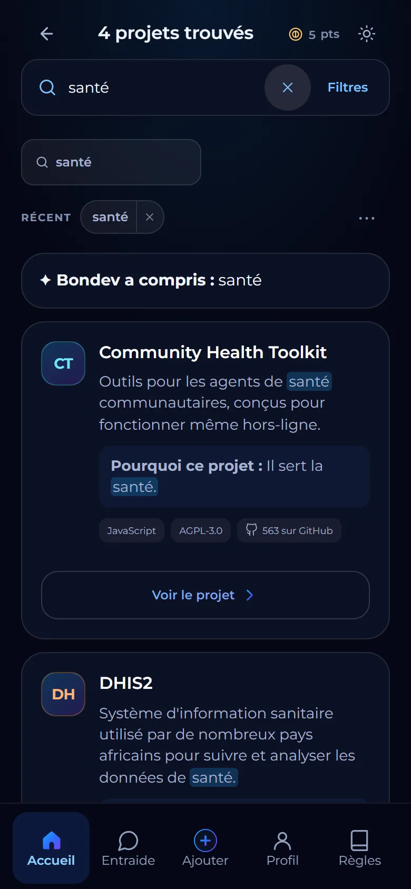
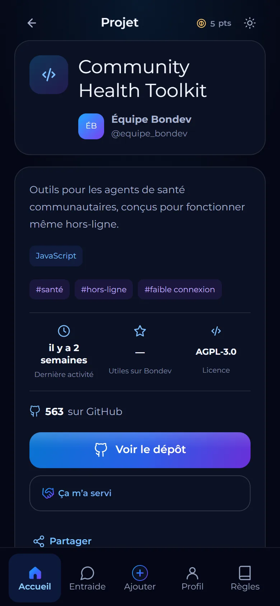
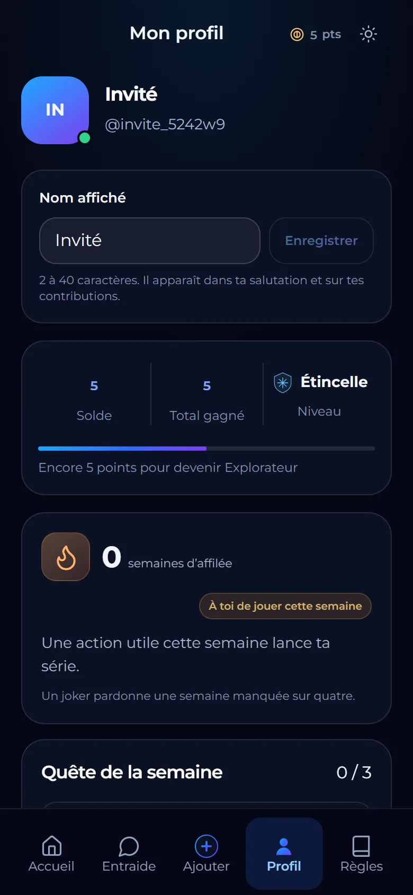
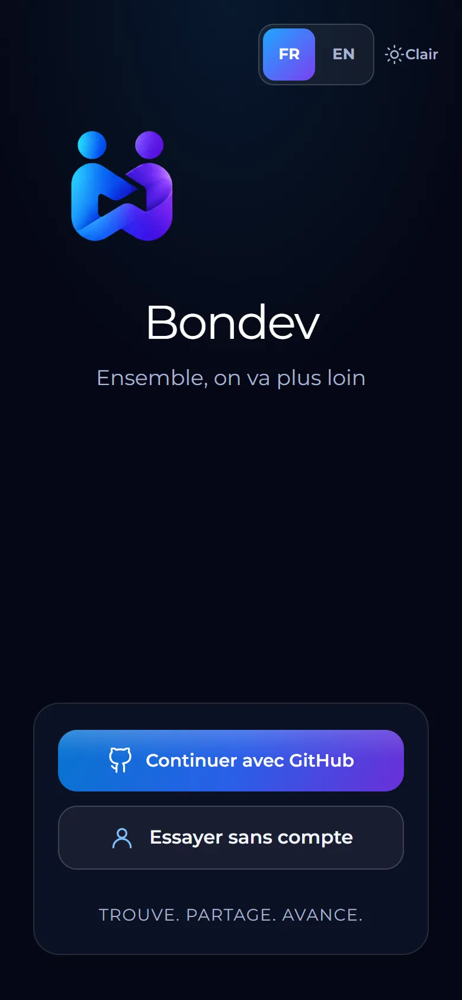

# Bondev

**Trouve ce qui existe, fais-toi aider, aide les autres.**

Bondev est une plateforme d'entraide pour les développeurs africains. Elle
réunit un catalogue de projets open source adaptés au contexte local, un forum
de questions avec des points d'entraide, et une progression communautaire
(niveaux, badges, séries, quêtes). L'application est une PWA mobile-first,
installable et utilisable hors-ligne pour la coquille et les dernières données
consultées.

[**Voir la démo →**](https://bondev.ngassakindzaa.workers.dev) ·
[Architecture](docs/ARCHITECTURE.md) ·
[Base de données](docs/DATABASE.md) ·
[Sécurité](SECURITY.md)

[](https://github.com/NGASSAKI003/bondev/actions/workflows/ci.yml)
[](LICENSE)

## Aperçu

| Accueil | Recherche |
| --- | --- |
|  |  |

| Fiche projet | Entraide |
| --- | --- |
|  |  |

| Fil de question | Profil et progression |
| --- | --- |
|  |  |

| Connexion | Thème clair |
| --- | --- |
|  |  |

## Le problème

Un développeur qui bloque sur un bug ou cherche un outil existant perd du temps
à filtrer des résultats pensés pour d'autres contextes : connexion instable,
Mobile Money, USSD, faible bande passante, langues locales. Les réponses
utiles, elles, restent souvent enfermées dans des groupes privés.

## La réponse

- **Chercher avant de coder.** Un moteur lexical français/anglais comprend les
  synonymes du domaine (santé, éducation, paiement mobile, hors-ligne…) et
  explique pourquoi chaque projet correspond.
- **Demander de l'aide.** Les questions ont un palier de 1, 3 ou 6 points, une
  question gratuite par semaine et expirent après 7 jours. Une seule réponse
  peut être validée : les points vont à la personne qui a réellement aidé.
- **Aider et progresser.** Répondre, valider, publier un projet ou dire
  « Ça m'a servi » alimente un registre de points, des niveaux (Étincelle →
  Légende), des badges et une série hebdomadaire avec joker.
- **Essayer sans compte.** Le mode invité permet de parcourir, poser une
  question et répondre immédiatement. La publication de projet et le
  « Ça m'a servi » restent réservés aux comptes réels.

## Fonctionnalités

- Catalogue de projets avec recherche par besoin, filtres, fiche détaillée,
  lien GitHub validé, licence, étoiles et compteur d'utilité.
- Entraide complète : filtres, paliers, expiration, preuve GitHub, validation
  d'une réponse, retrait et remboursement.
- Progression calculée côté client à partir de données publiques : niveau,
  série UTC avec joker, badges, spécialités, quête hebdomadaire et défi
  collectif.
- Profil : nom affiché, thème, langue FR/EN, économie de données, effets
  visuels, retour haptique, historique des points.
- Mode invité avec bannière de conversion et restrictions appliquées aussi
  côté base.
- PWA : installation, service worker versionné, mode hors-ligne et bandeau
  « Nouvelle version disponible / Actualiser ».
- Accessibilité : navigation clavier, focus géré, cibles de 44 px, contrastes
  AA, `prefers-reduced-motion`, textes alternatifs et lien d'évitement.
- Responsive de 320 px à 1920 px, thèmes sombre et clair.

## Stack

| Couche | Choix |
| --- | --- |
| Interface | React 19, TypeScript strict, Vite 8 |
| Styles | Tailwind CSS 4 + design system CSS maison |
| Données et auth | Supabase (PostgreSQL, PostgREST, Auth, RLS, RPC) |
| PWA | Manifeste, service worker natif, cache versionné |
| Hébergement | Cloudflare Workers / Pages, en-têtes dans `_headers` |
| Tests | Vitest (114 tests), TypeScript, ESLint 9 |
| CI/CD | GitHub Actions (lint, types, tests, build, audit) |

Aucune dépendance d'exécution superflue : React, React DOM et
`@supabase/supabase-js` uniquement.

## Architecture en bref

```text
React (SPA)
  ├─ AuthProvider ── Supabase Auth ── session / invité
  ├─ écrans lazy ─── lib/api.ts ───── PostgREST + RPC (RLS)
  ├─ lib/progress.ts  calcul pur : niveaux, séries, badges
  ├─ lib/search.ts    recherche lexicale, sans réseau
  └─ service worker   cache statique, réseau d'abord en navigation
```

Les points ne sont jamais écrits par le navigateur : `publish_project`,
`mark_project_used`, `post_question`, `validate_answer` et
`withdraw_question` sont des fonctions SQL `SECURITY DEFINER`. Le détail des
flux, de la sécurité et des choix de performance est dans
[`docs/ARCHITECTURE.md`](docs/ARCHITECTURE.md).

## Démarrage rapide

Prérequis : **Node.js 20 ou plus**, Git, et un projet Supabase.

```bash
git clone https://github.com/NGASSAKI003/bondev.git
cd bondev
npm ci
cp .env.example .env.local
```

Renseigne ensuite `.env.local` :

```env
VITE_SUPABASE_URL=https://ton-projet.supabase.co
VITE_SUPABASE_ANON_KEY=ta-cle-publishable
```

Exécute les migrations de `supabase/migrations/` dans l'ordre, puis :

```bash
npm run dev
```

L'application démarre sur `http://localhost:5173`. Sans configuration
Supabase, elle affiche un écran « Configuration requise » au lieu de planter.

### Connexion et mode invité

- Active **GitHub** dans *Authentication → Providers* pour le parcours
  principal.
- Active **Anonymous sign-ins** pour « Essayer sans compte ».
- Ajoute `http://localhost:5173` et l'URL de production dans les URL de
  redirection.
- Google et l'email sont masqués par défaut :
  `VITE_ENABLE_GOOGLE=true` et `VITE_ENABLE_EMAIL=true` les activent.

Les étapes détaillées, les RPC et les tests SQL sont dans
[`supabase/README.md`](supabase/README.md).

## Scripts

| Commande | Rôle |
| --- | --- |
| `npm run dev` | Serveur Vite avec rechargement à chaud. |
| `npm run build` | Build production + CSP, version du SW, contrôle des source maps. |
| `npm run preview` | Prévisualisation du build. |
| `npm run lint` | ESLint : React Hooks et jsx-a11y. |
| `npm run typecheck` | TypeScript strict, sans `any`. |
| `npm test` | 114 tests Vitest. |
| `npm run catalogue:build` | Régénère le catalogue GitHub (script ponctuel). |

## Qualité et sécurité

- CSP stricte : `default-src 'self'`, scripts et polices locaux, connexions
  limitées à Supabase et `api.github.com`. **L'origine Supabase est injectée
  au build** depuis `VITE_SUPABASE_URL`, jamais en dur.
- En-têtes : `X-Frame-Options: DENY`, `frame-ancestors 'none'`, `nosniff`,
  `Referrer-Policy`, `Permissions-Policy`, `Cross-Origin-Opener-Policy`, HSTS.
- RLS sur toutes les tables ; le solde n'est lisible que par son propriétaire ;
  `points_ledger` est en ajout seulement.
- Aucun `dangerouslySetInnerHTML`, aucun `any`, aucun `@ts-ignore`. Les liens
  externes sont validés en `https://` et portent
  `rel="noopener noreferrer"`.
- Service worker : jamais de cache pour les requêtes authentifiées ni les
  autres origines, purge des anciens caches à chaque déploiement.
- `npm audit` : 0 vulnérabilité au dernier contrôle.
- Aucune source map publiée : le build échoue si un `.map` apparaît dans
  `dist/`.
- Le workflow keepalive ne lit qu'une ligne publique avec la clé `anon`.

La politique de signalement est dans [`SECURITY.md`](SECURITY.md).

## Performance

Mesures Lighthouse mobile locales, build de production servi avec gzip et les
en-têtes réels de `dist/_headers` :

| Page | Performance | Accessibilité | Bonnes pratiques | SEO | LCP | TBT | CLS |
| --- | ---: | ---: | ---: | ---: | ---: | ---: | ---: |
| Connexion (publique) | 95 | 100 | 100 | 100 | 2,9 s | 60 ms | 0 |
| Accueil connecté (invité) | 91 | 100 | 100 | 100 | 2,5 s | 236 ms | 0,089 |

Ces scores varient avec la machine et les données Supabase. Le budget de build
est respecté :

| Élément | Taille gzip |
| --- | ---: |
| Entrée principale | **118,30 kB** (< 120 kB) |
| Chunk Supabase | 55,16 kB |
| CSS | 35,33 kB |
| Écrans lazy | 3,05 à 9,35 kB chacun |

Leviers : écrans lazy, chunk Supabase séparé, police variable préchargée,
images WebP, listes paginées, `content-visibility`, animations limitées à
`transform`/`opacity`, mode « effets légers » automatique sur mobile et
économie de données.

## Déploiement

1. Construire avec les variables de production :

   ```bash
   VITE_SUPABASE_URL=https://ton-projet.supabase.co \
   VITE_SUPABASE_ANON_KEY=ta-cle-publishable \
   npm run build
   ```

2. Déployer le contenu de `dist/` sur Cloudflare (Workers avec assets
   statiques ou Pages).
3. Vérifier que `_headers` est bien pris en compte : la CSP doit contenir
   l'origine Supabase réelle, et `/sw.js` doit être servi avec
   `Cache-Control: no-cache`.
4. Configurer les secrets GitHub `SUPABASE_URL` et `SUPABASE_ANON_KEY` pour le
   keepalive, puis activer le workflow.

Le détail du pipeline et du cache est dans
[`docs/ARCHITECTURE.md`](docs/ARCHITECTURE.md).

## Documentation

- [`docs/ARCHITECTURE.md`](docs/ARCHITECTURE.md) : flux, sécurité, performance,
  PWA et CI.
- [`docs/DATABASE.md`](docs/DATABASE.md) : tables, points, niveaux, RLS et
  fonctions SQL.
- [`supabase/README.md`](supabase/README.md) : installation, auth, tests SQL et
  keepalive.
- [`docs/TEST-TELEPHONE.md`](docs/TEST-TELEPHONE.md) : protocole de test mobile,
  mode d'effets et laboratoire de rendu.
- [`SECURITY.md`](SECURITY.md) : signalement et défenses en place.

## Limites connues

- La connexion GitHub/Google réelle dépend de la configuration OAuth du projet
  Supabase ; elle n'est pas couverte par les tests automatisés.
- La recherche est lexicale, pas sémantique.
- Le mode invité ne peut pas publier de projet ni marquer « Ça m'a servi ».
- Safari/iOS, les lecteurs d'écran et le clavier virtuel natif n'ont pas été
  validés sur appareil physique.
- Les questions d'exemple encore présentes dans l'instance de démonstration
  peuvent dater ; `supabase/seed.sql` fournit un jeu de données propre pour un
  nouveau projet.

## Licence

[MIT](LICENSE) © 2026 **Anaclet Julien NGASSAKI-NDZA**
