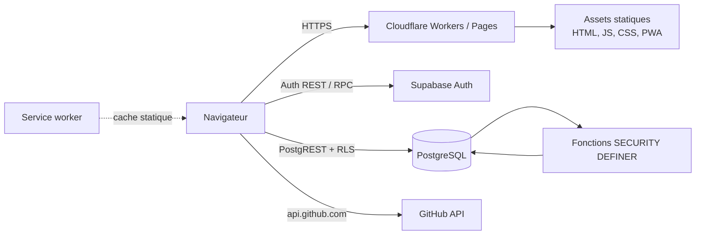
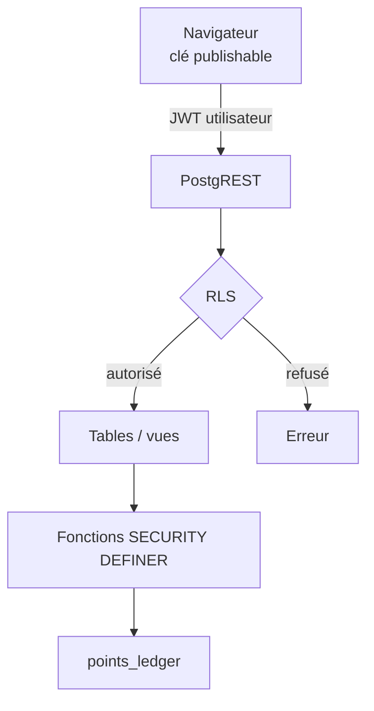

# Architecture de Bondev

Bondev est une application web mobile-first qui relie trois parcours :
chercher un projet open source, demander ou apporter de l'aide, et suivre une
progression communautaire. Le front est une SPA React servie en statique ; les
données, l'authentification et les règles métier vivent dans Supabase.

## Vue d'ensemble



- **Hébergement** : fichiers de `dist/` servis par Cloudflare, avec
  `public/_headers` (CSP, HSTS, anti-framing, permissions).
- **Front** : React 19, TypeScript strict, Vite 8, Tailwind CSS 4.
- **Backend** : Supabase (PostgreSQL, PostgREST, Auth, RLS, RPC).
- **PWA** : manifeste, icônes maskables, service worker versionné et bandeau de
  mise à jour.
- **Aucun serveur applicatif propre** : les règles sensibles sont dans des
  fonctions SQL `SECURITY DEFINER`, pas dans le navigateur.

## Organisation du dépôt

```text
.
├─ src/
│  ├─ App.tsx                 # coquille, navigation, états globaux, célébrations
│  ├─ screens/                # écrans lourds chargés en lazy
│  ├─ components/             # UI réutilisable, bannière invité, mise à jour
│  ├─ lib/
│  │  ├─ api.ts               # toutes les lectures/écritures Supabase + erreurs FR
│  │  ├─ auth.tsx             # session, profil, stats, mode invité
│  │  ├─ progress.ts          # calcul pur des niveaux, séries et badges
│  │  ├─ search.ts            # recherche lexicale et synonymes, sans réseau
│  │  ├─ router.ts            # routes hash testables
│  │  ├─ effects.ts           # choix du mode d'effets (auto / complet / léger)
│  │  └─ serviceWorker.ts     # enregistrement et détection de mise à jour
│  ├─ i18n.tsx                # traduction FR/EN à la volée
│  └─ index.css               # design system, thèmes, responsive, PWA
├─ public/
│  ├─ _headers                # en-têtes de sécurité (CSP avec jeton Supabase)
│  ├─ sw.js                   # service worker (réseau d'abord en navigation)
│  ├─ manifest.webmanifest    # métadonnées PWA
│  └─ fonts/, assets/         # polices et images auto-hébergées
├─ scripts/
│  ├─ build-artifacts.mjs     # CSP, version SW, contrôle des source maps
│  └─ catalogue/              # génération du catalogue GitHub
├─ supabase/
│  ├─ migrations/             # 0001 → 0005, à exécuter dans l'ordre
│  ├─ seed.sql                # données d'exemple
│  ├─ catalogue_depart.sql    # catalogue initial généré
│  └─ tests/                  # tests SQL des règles et de la RLS
├─ docs/                      # architecture, base, protocole de test, captures
└─ .github/workflows/         # CI et keepalive Supabase
```

## Démarrage de l'application

1. `index.html` applique le thème avant la première peinture grâce à
   `theme-init.js`, affiche un splash CSS pur et précharge la police.
2. `src/main.tsx` lit les préférences locales (thème, effets, économie de
   données), enregistre le service worker et monte React.
3. `AuthProvider` restaure la session Supabase. Si aucune session n'existe,
   l'écran de connexion propose GitHub, Google/email (optionnels) ou le mode
   invité (`signInAnonymously`).
4. Pour un nouvel utilisateur, `ensureProfile` crée la ligne `profiles`. Le
   trigger SQL ajoute les 5 points de bienvenue.
5. Une fois le profil présent, les statistiques et la progression sont lues.
   Ce séquencement évite une erreur artificielle sur un compte tout neuf.
6. `App` applique la route du fragment (`#/…`), charge l'écran correspondant et
   restaure la position de défilement.

## Navigation et rendu

Le routeur (`src/lib/router.ts`) est un module pur, testé avec Vitest. Il
reconnaît les écrans fixes, la recherche (`?q=`), les UUID de projet et de
question, et renvoie une 404 pour tout le reste.

- Les écrans lourds (Entraide, Profil, Règles, Partage) sont chargés avec
  `React.lazy` et un squelette `Suspense`.
- Le bundle Supabase est isolé dans son propre chunk par
  `vite.config.ts`.
- Les transitions utilisent `document.startViewTransition` quand il existe,
  avec repli CSS. Le mode « effets légers » et `prefers-reduced-motion` les
  désactivent.
- `history.pushState` est synchronisé avec le fragment ; les feuilles, filtres
  et célébrations n'ajoutent pas d'entrée.

## Données et règles métier

### Tables principales

| Table | Rôle |
| --- | --- |
| `profiles` | Profil public lié à `auth.users`. |
| `projects` | Catalogue de projets open source. |
| `project_uses` | Un « Ça m'a servi » par utilisateur et par projet. |
| `questions` | Questions d'entraide avec palier, expiration et statut. |
| `answers` | Réponses, validation et preuve GitHub facultative. |
| `points_ledger` | Registre immuable des mouvements de points. |
| `profile_stats` (vue) | Profil, solde privé, total gagné public et niveau. |

### Écritures sensibles

Le navigateur ne fait jamais d'`INSERT` dans `points_ledger`. Les opérations
qui touchent aux points passent par des RPC :

- `publish_project` : publie un projet et récompense l'auteur ;
- `mark_project_used` : crédite l'auteur d'un projet utile ;
- `post_question` : débite le palier ou consomme la question gratuite ;
- `validate_answer` : attribue les points à la réponse validée ;
- `withdraw_question` : rembourse une question retirée ;
- `expire_questions` : tâche planifiée qui ferme les questions échues.

Les réponses sont insérées directement dans `answers`, mais uniquement avec
`question_id`, `author_id`, `body` et `proof_url` : `is_useful` et `visible`
sont réservés aux RPC.

### Progression

`src/lib/progress.ts` est un module **pur** : aucune requête, aucun stockage.
Il reçoit les lignes lues par `fetchProgressRaw()` et calcule :

- le niveau (seuils identiques à `public.level_for`) ;
- les semaines UTC actives et la série avec joker ;
- les badges (entraide, partage, utilité, série, spécialités, communauté) ;
- la quête hebdomadaire et le défi collectif.

`getProgress()` ajoute un cache mémoire de 60 secondes et un cache
`localStorage` pour le hors-ligne. Le cache est invalidé après une action qui
change les points.

## Sécurité



- La clé `service_role` n'est jamais utilisée côté client.
- Toutes les tables publiques ont la RLS activée ; `profile_stats` est une vue
  `security_invoker` qui n'expose le solde qu'à son propriétaire.
- Les fonctions sensibles vérifient `auth.uid()`, l'auteur, le statut et les
  plafonds avant d'écrire.
- La migration `0005_invites.sql` interdit aux comptes anonymes la publication
  de projet et le « Ça m'a servi ».
- La CSP est stricte et son origine Supabase est injectée au build. Les liens
  externes sont validés en `https://` et ouverts avec
  `rel="noopener noreferrer"`. Aucun `dangerouslySetInnerHTML`.
- Les en-têtes Cloudflare ajoutent HSTS, `X-Frame-Options: DENY`,
  `nosniff`, `Referrer-Policy` et `Permissions-Policy`.

Voir aussi [SECURITY.md](../SECURITY.md).

## Performance

- Entrée principale sous 120 kB gzip, Supabase dans un chunk séparé.
- CSS unique, police Montserrat variable préchargée et auto-hébergée.
- Images en WebP avec dimensions explicites ; aperçu social compressé.
- Écrans lourds chargés à la demande, listes paginées par 20 et rendu
  progressif.
- `content-visibility` sur les cartes hors écran, écouteurs de défilement
  passifs et regroupés par `requestAnimationFrame`.
- Animations limitées à `transform` et `opacity`, coupées par
  `prefers-reduced-motion` ou le mode « effets légers ».
- Aucune source map publiée : `scripts/build-artifacts.mjs` échoue si un `.map`
  apparaît dans `dist/`.

## PWA et disponibilité

`public/sw.js` applique trois règles :

1. **Navigation** : réseau d'abord, cache de la coquille `/` en secours.
2. **Statique same-origin** : cache d'abord, rafraîchissement en arrière-plan.
3. **Jamais de cache** pour les requêtes authentifiées (`Authorization`) ni
   pour les autres origines (Supabase, GitHub, avatars).

Le jeton `__BUILD_VERSION__` est remplacé au build par la version du paquet et
le SHA du commit. À l'activation, tous les caches `bondev-*` plus anciens sont
supprimés. Quand un nouveau service worker est détecté, `UpdateBanner` propose
« Nouvelle version disponible » et « Actualiser ».

Le workflow `.github/workflows/keepalive.yml` appelle l'API Supabase tous les
trois jours avec les secrets `SUPABASE_URL` et `SUPABASE_ANON_KEY`, afin
d'éviter la mise en pause d'un projet gratuit. Ce ping est en lecture seule.

## Tests et qualité

| Commande | Vérifie |
| --- | --- |
| `npm run lint` | ESLint 9, règles React Hooks et jsx-a11y. |
| `npm run typecheck` | TypeScript strict, sans `any` ni `@ts-ignore`. |
| `npm test` | 114 tests Vitest : routeur, recherche, progression, invités, effets. |
| `npm run build` | Build production + artefacts CSP/SW/source maps. |
| `npm audit --audit-level=high` | Vulnérabilités des dépendances. |

La CI GitHub exécute ces cinq étapes sur chaque push et pull request vers
`dev` et `main`. Les tests SQL de `supabase/tests/` se lancent séparément dans
un projet Supabase de test.

## Limites connues

- La connexion GitHub/Google réelle dépend de la configuration OAuth du projet
  Supabase et n'est pas automatisable dans la CI.
- La recherche est lexicale (synonymes et score), pas sémantique.
- Le mode invité est volontairement limité : pas de publication de projet ni de
  « Ça m'a servi ».
- Les mesures Lighthouse sont locales et varient avec la charge de la machine
  et les données Supabase.
- Safari/iOS, les lecteurs d'écran et le clavier virtuel natif n'ont pas été
  validés sur appareil physique.
