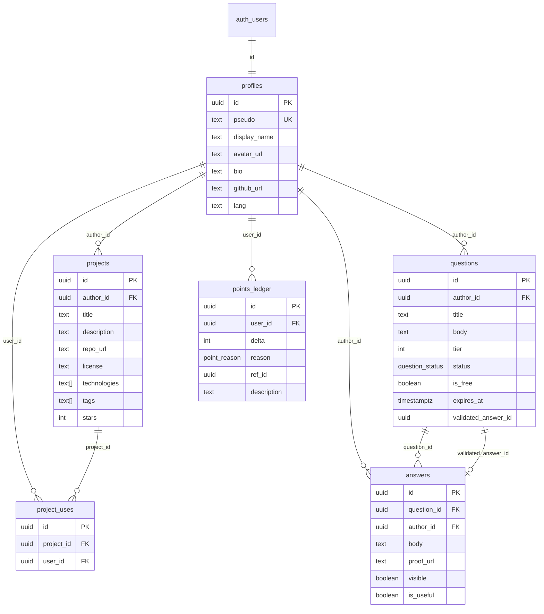

# 📖 Base de données Bondev

> Guide simple pour comprendre et utiliser la base de données de Bondev.  
> Écrit pour des étudiants qui découvrent Supabase.

---

## 📋 Table des matières

1. [C'est quoi Supabase ?](#cest-quoi-supabase-)
2. [Les tables](#les-tables)
3. [Comment marchent les points ?](#comment-marchent-les-points-)
4. [Les niveaux](#les-niveaux)
5. [Les fonctions (les « boutons » de la base)](#les-fonctions-les--boutons--de-la-base)
6. [La sécurité (RLS)](#la-sécurité-rls)
7. [Expiration des questions (tâche planifiée)](#expiration-des-questions-tâche-planifiée)
8. [Installer et lancer](#installer-et-lancer)
9. [Schéma visuel](#schéma-visuel)
10. [Questions fréquentes](#questions-fréquentes)

---

## C'est quoi Supabase ?

**Supabase** est une base de données PostgreSQL hébergée dans le cloud, avec une API automatique. Concrètement :

- Tu crées des **tables** (comme un tableur Google Sheets, mais plus puissant).
- Supabase génère automatiquement une **API REST** : ton application React peut lire et écrire les données via des appels HTTP.
- Il gère aussi l'**authentification** (connexion GitHub, Google, email).
- Il y a un **éditeur SQL** en ligne pour exécuter des commandes directement.

> [!TIP]
> Tu n'as pas besoin d'installer PostgreSQL sur ton ordinateur. Tout se fait dans le navigateur sur [supabase.com](https://supabase.com).

---

## Les tables

Bondev utilise **6 tables** et **1 vue** :

| Table | Rôle | Qui peut écrire ? |
|-------|------|-------------------|
| `profiles` | Profil de chaque utilisateur (pseudo, bio, avatar…) | L'utilisateur lui-même |
| `projects` | Catalogue de projets open source | Via la fonction `publish_project` |
| `project_uses` | « Ça m'a servi » (un clic = un utilisateur a trouvé le projet utile) | Via la fonction `mark_project_used` |
| `questions` | Questions d'entraide avec mise en jeu de points | Via la fonction `post_question` |
| `answers` | Réponses aux questions | L'auteur de la réponse |
| `points_ledger` | Registre de tous les mouvements de points | ⛔ Personne directement ! Seulement les fonctions SQL |

| Vue | Rôle |
|-----|------|
| `profile_stats` | Profil + solde + total gagné + niveau (lecture seule) |

### Détail de chaque table

#### `profiles`
```
id            → identifiant unique (lié à auth.users)
pseudo        → nom d'utilisateur unique (3 à 30 caractères, lettres/chiffres/_/-)
display_name  → nom affiché (ex. "Amadou Diallo")
avatar_url    → lien vers la photo de profil
bio           → courte description
github_url    → lien GitHub
lang          → langue préférée : "fr" ou "en"
```

#### `projects`
```
id            → identifiant unique
author_id     → qui a publié le projet
title         → titre du projet (5 à 200 caractères)
description   → description détaillée
repo_url      → lien vers le dépôt Git
license       → licence (MIT, Apache-2.0, GPL-3.0…)
technologies  → liste : {"React", "Node.js", "Python"}
tags          → étiquettes : {"Mobile Money", "hors-ligne", "USSD"}
stars         → nombre de « ça m'a servi »
last_activity → date de la dernière activité
```

#### `questions`
```
id            → identifiant unique
author_id     → qui a posé la question
title         → titre (5 à 300 caractères)
body          → texte de la question
technologies  → technologies concernées
tier          → palier de points : 1, 3 ou 6
github_url    → lien GitHub facultatif
beginner_ok   → cocher si les débutants sont bienvenus
status        → open / resolved / expired / withdrawn
is_free       → true si c'est la question gratuite de la semaine
expires_at    → date d'expiration (7 jours après publication)
validated_answer_id → la réponse validée (ou null)
```

#### `answers`
```
id            → identifiant unique
question_id   → quelle question cette réponse concerne
author_id     → qui a écrit cette réponse
body          → texte de la réponse
proof_url     → lien de preuve (issue GitHub, PR…), facultatif
visible       → la réponse est-elle visible ?
is_useful     → marquée comme utile par l'auteur de la question ?
```

#### `points_ledger` (le registre des points)
```
id            → identifiant unique
user_id       → à qui appartient ce mouvement
delta         → combien de points (+5, -3, +1…)
reason        → pourquoi : signup, hold, reward, refund, project_publish, project_used, free_question
ref_id        → référence vers la question ou le projet concerné
description   → texte explicatif
created_at    → quand ce mouvement a eu lieu
```

> [!IMPORTANT]
> **Le registre des points est en ajout seulement.** On n'y fait jamais d'UPDATE ni de DELETE. Le solde = la somme de tous les `delta`. C'est comme un relevé bancaire : on ne modifie jamais une ligne, on ajoute une nouvelle écriture.

---

## Comment marchent les points ?

### À l'inscription
Tu reçois **5 points de départ** + **1 question gratuite par semaine**.

### Poser une question
- Tu choisis un palier : **1, 3 ou 6 points**.
- Ces points sont **mis de côté** (ils sortent de ton solde mais ne sont pas encore donnés).
- Si tu n'as pas assez de points, tu peux utiliser ta **question gratuite de la semaine** (palier 1 seulement).

### Quelqu'un t'aide → tu valides
- Quand tu valides une réponse, les points mis de côté vont à l'auteur de la réponse.
- Tu ne peux **pas valider ta propre réponse**.
- Tu ne peux valider qu'**une seule réponse** par question.

### Personne ne t'aide → expiration
- Après **7 jours** sans validation, la question expire et tes points te sont **remboursés**.

### Tu changes d'avis → retrait
- Tu peux retirer ta question tant qu'aucune réponse n'a été validée. Points remboursés.

### Publier un projet
- **+3 points** à la publication.

### « Ça m'a servi »
- Quand quelqu'un clique « Ça m'a servi » sur ton projet, tu gagnes **+1 point**.
- Un seul clic par utilisateur et par projet.
- Maximum 10 clics par semaine et par projet (pour éviter les abus).
- Tu ne peux **pas** cliquer sur ton propre projet.

### Solde vs Total gagné

| | Solde | Total gagné |
|---|---|---|
| Quoi ? | Points disponibles maintenant | Points gagnés depuis le début |
| Baisse quand tu poses une question ? | ✅ Oui | ❌ Non |
| Monte avec les remboursements ? | ✅ Oui | ❌ Non |
| Sert à quoi ? | Savoir combien tu peux dépenser | Déterminer ton niveau |

---

## Les niveaux

Ton niveau dépend de ton **total gagné** (pas de ton solde) :

| Niveau | Points nécessaires |
|--------|-------------------|
| 🌱 Étincelle | 0 |
| 🔍 Explorateur | 10 |
| 🧱 Bâtisseur | 30 |
| 🎓 Mentor | 70 |
| ⭐ Maître | 150 |
| 🏆 Légende | 300 |

> [!NOTE]
> Le niveau ne baisse jamais, car le total gagné ne baisse jamais. Les remboursements et les dépenses n'affectent pas le total gagné.

---

## Les fonctions (les « boutons » de la base)

Le navigateur (React) ne peut **jamais** écrire directement dans `points_ledger`. Toutes les opérations qui touchent aux points passent par des **fonctions SQL sécurisées** :

| Fonction | Ce qu'elle fait | Qui peut l'appeler ? |
|----------|----------------|---------------------|
| `post_question(...)` | Publie une question et déduit les points | L'utilisateur connecté |
| `validate_answer(answer_id)` | Valide une réponse et verse la cagnotte | L'auteur de la question |
| `withdraw_question(question_id)` | Retire une question et rembourse | L'auteur de la question |
| `expire_questions()` | Expire les questions de plus de 7 jours | Tâche planifiée (voir plus bas) |
| `publish_project(...)` | Publie un projet et donne +3 points | L'utilisateur connecté |
| `mark_project_used(project_id)` | « Ça m'a servi » : +1 point à l'auteur | L'utilisateur connecté |

### Fonctions utilitaires

| Fonction | Ce qu'elle retourne |
|----------|-------------------|
| `get_balance(user_id)` | Le solde courant |
| `get_total_earned(user_id)` | Le total des points gagnés |
| `level_for(total_earned)` | Le nom du niveau |
| `has_free_question(user_id)` | `true` si la question gratuite de la semaine est encore disponible |

### Comment appeler une fonction depuis React ?

```typescript
// Exemple : poster une question
const { data, error } = await supabase.rpc('post_question', {
  p_title: 'Mon paiement Mobile Money ne marche pas',
  p_body: 'Voici mon erreur...',
  p_technologies: ['Node.js'],
  p_tier: 3,
  p_github_url: 'https://github.com/mon-projet',
  p_beginner_ok: true
})

// Exemple : valider une réponse
await supabase.rpc('validate_answer', { p_answer_id: '...' })

// Exemple : récupérer le profil avec les stats
const { data } = await supabase
  .from('profile_stats')
  .select('*')
  .eq('id', userId)
  .single()
```

---

## La sécurité (RLS)

**RLS** = Row Level Security. C'est un système de Supabase (PostgreSQL) qui contrôle **qui peut voir et modifier chaque ligne** de chaque table.

### Résumé des règles

| Table | Lecture | Écriture |
|-------|--------|----------|
| `profiles` | 🌍 Tout le monde | ✏️ Seulement toi, sur ton propre profil |
| `projects` | 🌍 Tout le monde | ✏️ Seulement l'auteur |
| `project_uses` | 🌍 Tout le monde | ⛔ Seulement via `mark_project_used` |
| `questions` | 🌍 Tout le monde | ⛔ Seulement via les fonctions SQL |
| `answers` | 🌍 Réponses visibles (ou tes propres réponses) | ✏️ L'auteur (sauf si validée) |
| `points_ledger` | 🔒 Seulement tes propres lignes | ⛔ Personne ! Seulement les fonctions SQL |

> [!CAUTION]
> **Ne désactive jamais la RLS** en production. Sans elle, n'importe qui pourrait modifier les points de n'importe qui.

---

## Expiration des questions (tâche planifiée)

La fonction `expire_questions()` doit être appelée régulièrement (toutes les heures par exemple) pour expirer les questions ouvertes depuis plus de 7 jours.

### Option A : pg_cron (recommandé si disponible)

`pg_cron` est une extension PostgreSQL qui permet de planifier des tâches directement dans la base de données. Elle est disponible sur le plan Pro de Supabase.

```sql
-- Activer l'extension (une seule fois, dans l'éditeur SQL de Supabase)
CREATE EXTENSION IF NOT EXISTS pg_cron;

-- Planifier l'expiration toutes les heures
SELECT cron.schedule(
  'expire-questions',          -- nom de la tâche
  '0 * * * *',                 -- toutes les heures, à la minute 0
  $$SELECT public.expire_questions()$$
);
```

Pour vérifier que ça marche :
```sql
-- Voir les tâches planifiées
SELECT * FROM cron.job;

-- Voir l'historique des exécutions
SELECT * FROM cron.job_run_details ORDER BY start_time DESC LIMIT 10;
```

> [!NOTE]
> `pg_cron` n'est pas disponible sur le plan gratuit de Supabase. Utilise l'option B dans ce cas.

### Option B : Supabase Edge Function + cron externe

Si `pg_cron` n'est pas disponible, crée une **Edge Function** qui appelle `expire_questions()` :

1. Crée une Edge Function `supabase/functions/expire-questions/index.ts` :

```typescript
import { createClient } from 'https://esm.sh/@supabase/supabase-js@2'

Deno.serve(async (req) => {
  // Vérifier un secret pour empêcher les appels non autorisés
  const authHeader = req.headers.get('Authorization')
  if (authHeader !== `Bearer ${Deno.env.get('CRON_SECRET')}`) {
    return new Response('Non autorisé', { status: 401 })
  }

  const supabase = createClient(
    Deno.env.get('SUPABASE_URL')!,
    Deno.env.get('SUPABASE_SERVICE_ROLE_KEY')!
  )

  const { data, error } = await supabase.rpc('expire_questions')

  if (error) {
    return new Response(JSON.stringify({ error: error.message }), { status: 500 })
  }

  return new Response(JSON.stringify({ expired: data }), { status: 200 })
})
```

2. Configure un **cron externe** (GitHub Actions, cron-job.org, etc.) pour appeler cette fonction toutes les heures.

Exemple avec **cron-job.org** (gratuit) :
- URL : `https://ton-projet.supabase.co/functions/v1/expire-questions`
- Méthode : POST
- Header : `Authorization: Bearer TON_CRON_SECRET`
- Fréquence : toutes les heures

Exemple avec **GitHub Actions** :
```yaml
# .github/workflows/expire-questions.yml
name: Expire questions
on:
  schedule:
    - cron: '0 * * * *'  # toutes les heures
jobs:
  expire:
    runs-on: ubuntu-latest
    steps:
      - run: |
          curl -X POST \
            -H "Authorization: Bearer ${{ secrets.CRON_SECRET }}" \
            https://ton-projet.supabase.co/functions/v1/expire-questions
```

---

## Installer et lancer

### 1. Crée un projet Supabase

Va sur [supabase.com](https://supabase.com), crée un compte, puis un projet.

### 2. Exécute la migration

Dans l'**éditeur SQL** de Supabase (menu SQL Editor) :
1. Copie-colle le contenu de `supabase/migrations/0001_init.sql`
2. Clique sur **Run**

### 3. Exécute le seed (données d'exemple)

Toujours dans l'éditeur SQL :
1. Copie-colle le contenu de `supabase/seed.sql`
2. Clique sur **Run**

### 4. Vérifie que tout marche

Exécute `supabase/tests/rules.sql` dans l'éditeur SQL.  
Tu devrais voir `✅ TOUS LES TESTS PASSENT (12/12)` dans les messages.

### 5. Configure l'expiration

Choisis l'option A ou B décrite plus haut.

### 6. Connecte React

Dans ton code React, installe le client Supabase :
```bash
npm install @supabase/supabase-js
```

Puis crée un fichier `src/lib/supabase.ts` :
```typescript
import { createClient } from '@supabase/supabase-js'

export const supabase = createClient(
  'https://ton-projet.supabase.co',  // URL de ton projet
  'eyJ...'                            // clé publique (anon key)
)
```

> [!WARNING]
> N'utilise **jamais** la clé `service_role` dans le code React. Utilise uniquement la clé `anon` (publique). La sécurité est assurée par la RLS.

---

## Schéma visuel



---

## Questions fréquentes

### « Pourquoi on ne peut pas écrire directement dans `points_ledger` ? »

Pour éviter la triche. Si le navigateur pouvait écrire dans cette table, n'importe qui pourrait se donner des points en modifiant les requêtes. Les fonctions SECURITY DEFINER vérifient toutes les règles avant d'écrire.

### « C'est quoi SECURITY DEFINER ? »

C'est un mode spécial des fonctions PostgreSQL. Normalement, une fonction s'exécute avec les permissions de l'utilisateur qui l'appelle. Avec `SECURITY DEFINER`, elle s'exécute avec les permissions de celui qui l'a **créée** (le propriétaire de la base). Ça lui permet de contourner les règles RLS pour écrire dans `points_ledger`, tout en vérifiant `auth.uid()` dans son code.

### « Comment je sais combien de points j'ai ? »

```typescript
// Depuis React
const { data } = await supabase
  .from('profile_stats')
  .select('balance, total_earned, level')
  .eq('id', userId)
  .single()

console.log(data)
// { balance: 8, total_earned: 34, level: "Bâtisseur" }
```

### « Comment je vois l'historique de mes points ? »

```typescript
const { data } = await supabase
  .from('points_ledger')
  .select('*')
  .order('created_at', { ascending: false })
// Grâce à la RLS, tu ne vois que TES propres lignes
```

### « Qu'est-ce qui se passe si deux personnes valident en même temps ? »

C'est impossible. La fonction `validate_answer` vérifie que `validated_answer_id` est encore `NULL` avant de mettre à jour. PostgreSQL gère les accès concurrents (transactions) automatiquement.

### « Comment tester en local ? »

Tu peux installer la CLI Supabase pour avoir une base locale :
```bash
npx supabase init
npx supabase start
npx supabase db reset  # exécute les migrations + seed
```

Puis exécute les tests :
```bash
psql -h localhost -p 54322 -U postgres -d postgres -f supabase/tests/rules.sql
```
